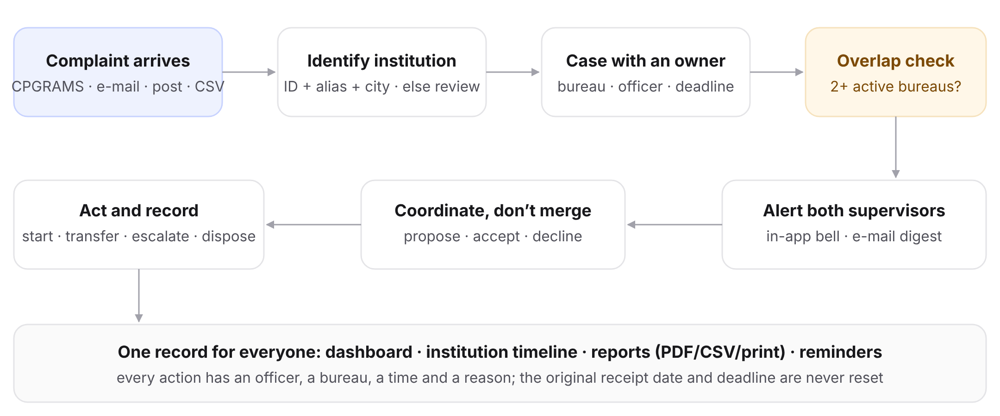
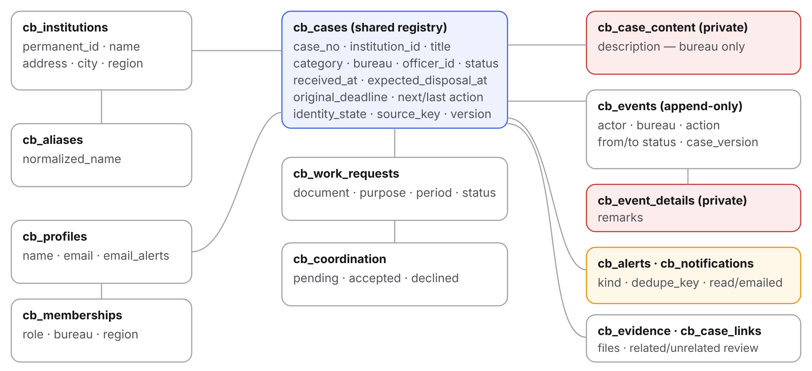
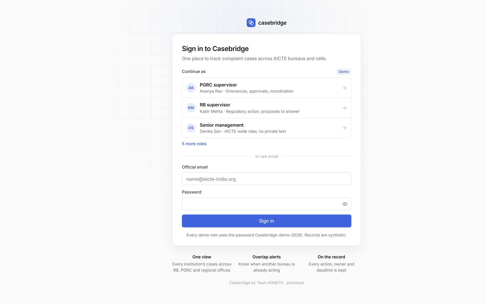
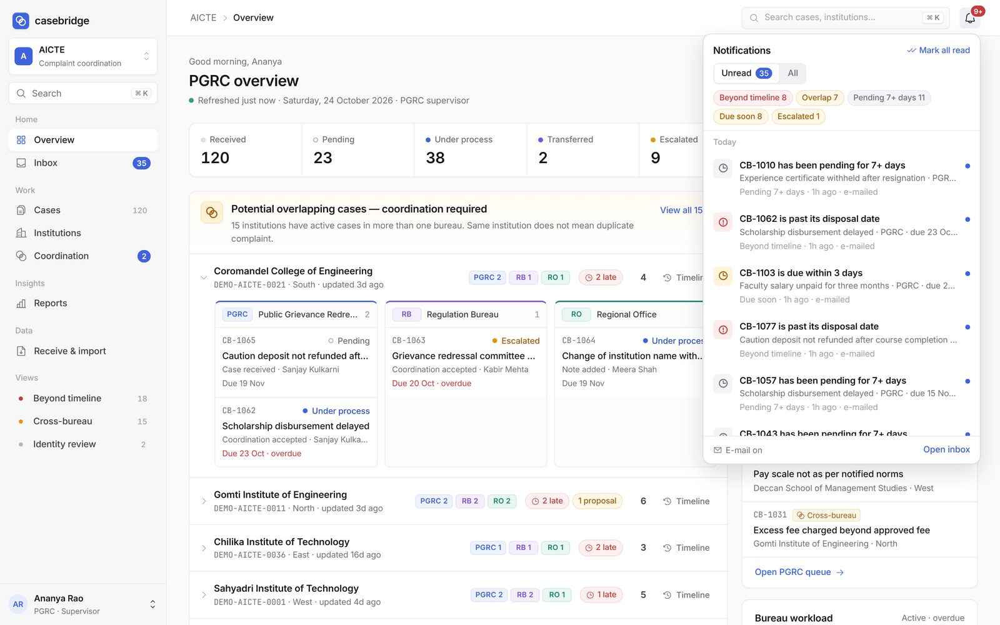
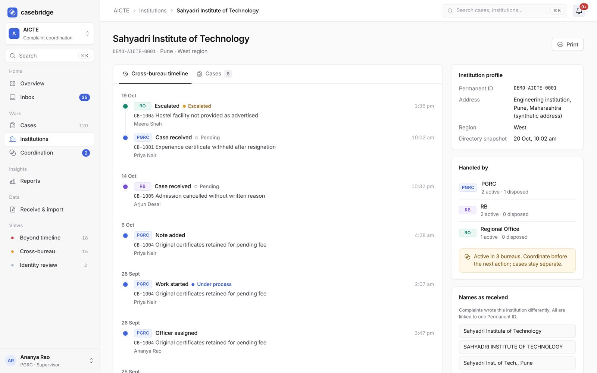
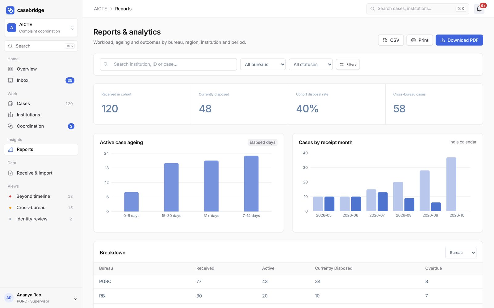

<div align="center">

# Casebridge
### by Team AGNEYA

**One view of every complaint about an institution, across AICTE bureaus and cells.**

Track every complaint with an owner and a deadline · detect when two bureaus act on the same institution · coordinate without merging cases


</div>

| | |
|---|---|
| 🟢 **Live application** | [DEPLOYMENT_URL] — *hosted link will be added here* |
| 🎬 **Demo video** | [VIDEO_URL] |
| 📂 **Public source code** | https://github.com/r11shi/agneya |
| 🔒 **Complete implementation** | Available to authorised evaluators on request (read-only access to our private repository) |
| 🔑 **Demo sign-in** | Click any role on the sign-in page, or `ananya.pgrc@demo.casebridge.test` / `Casebridge-demo-2026!` (synthetic data) |

> © 2026 Team AGNEYA. All rights reserved. This repository is published for evaluation only; no licence or reuse permission is granted. See [COPYRIGHT.md](COPYRIGHT.md).

---

## 1. Problem statement
*Integrated dashboard for monitoring and tracking institution-related complaint cases across AICTE bureaus/cells.*

## 2. Problem overview
AICTE receives complaints about technical institutions. They are handled by different bureaus and cells: the Public Grievance Redressal Cell (PGRC), the Regulation Bureau (RB) and regional offices. Each keeps its own file, officer and deadline. The same institution can be handled in two places at once without either side knowing, which leads to duplicate record requests, conflicting action and delayed disposal.

## 3. Our solution
A single, institution-first workspace:
- every complaint has an owner, a status, a next action and a deadline;
- complaints are linked to one institution profile even when the name is written differently;
- when more than one bureau is active on the same institution, the supervisors concerned see **"Potential overlapping cases — coordination required"**, in the app and by e-mail;
- bureaus coordinate (propose, accept or decline sharing work) — **cases are never merged, closed or hidden automatically**; officials decide and every action is recorded.

## 4. Key capabilities
| Area | What it does |
|---|---|
| Institution profile | Permanent ID, address, region, every complaint, a cross-bureau action timeline, names as received |
| Case tracking | Case ID, receipt date, category, status, bureau, officer, last and next action, expected disposal date |
| Overlap detection | Automatic cross-bureau awareness with alerts to the involved supervisors |
| Dashboard | Received, pending, under process, transferred, escalated, disposed, beyond timeline; bureau workload |
| Action history | Who did what, when and why; transfers keep the original deadline |
| Search and filters | Institution, Permanent ID, case ID, bureau, region, category, status, date range; ⌘K search |
| Alerts | Overlap, beyond timeline, due soon, pending 7+ days, escalated, coordination, transfer; e-mail digest |
| Reports | By bureau, region, institution, status, month and quarter; ageing; disposal rate; PDF, print, CSV |
| Roles | Officer, supervisor, regional reader, senior management, administrator |
| Privacy | Other bureaus see that a case exists, not the private complaint text |

## 5. System architecture




The browser talks to thin server routes. The server verifies the signed-in official and runs each change as a single database transaction that records the new state, the history entry and any alerts together. The database enforces permissions itself (row-level security), so the user interface is never the only guard.



## 6. Technology stack
Next.js 16 · React 19 · TypeScript · Base UI · Phosphor icons · Inter · Recharts · jsPDF · zod · Better Auth · PostgreSQL (Neon) · SMTP · Railway

## 7. Implementation overview (what you can read here)
| Path | What to look at |
|---|---|
| `src/components/workspace.tsx` | App shell: view routing from the URL, breadcrumbs, polling with refetch on focus/reconnect, keyboard shortcuts |
| `src/components/sidebar.tsx`, `command-palette.tsx` | Navigation groups, ⌘K search with keyboard handling |
| `src/components/overlap-feed.tsx` | Groups active cases by institution and bureau for the overlap view |
| `src/components/case-detail.tsx` | Case page: timeline strip, activity feed, note composer, action and coordination forms (optimistic-concurrency version and idempotency key sent with every command) |
| `src/components/notification-panel.tsx` | Notification popover and inbox with unread counts |
| `src/components/reports-view.tsx` | Report charts, CSV export with formula-injection guard, client-side PDF generation |
| `src/components/new-case.tsx`, `intake-view.tsx` | Intake form and CSV import UI |
| `src/components/api.ts` | Fetch wrapper, error handling, `useResource` polling hook with request cancellation |
| `src/contracts/*` | zod schemas and shared types for every request and response |
| `src/app/globals.css`, `polish.css` | Design tokens, components, motion, print styles |

### What is not included
To protect our work, this repository contains the **user interface and the shared request/response schemas only**. The following exist in our private repository and power the live application, but are **not published**:
- server routes, authentication and session handling, and domain services;
- all database migrations: tables, row-level security policies, command functions, triggers;
- the overlap detection, notification and e-mail pipeline;
- the institution name-matching rules (served from the server, never sent to browsers);
- the coordination checks, deadline scan, reporting queries and optional AI comparison;
- the synthetic data generator and all tests.

Because of this, the code here **typechecks but does not run as a full application** on its own. Please use the live application to try it. Evaluators who need to inspect the complete implementation can request read-only access (see below).

## 8. Screenshots
| | |
|---|---|
|  |  |
|  |  |
|  |  |

## 9. Live demonstration
The walkthrough at the top of this page was recorded from the running application. To try it yourself:

1. Open [DEPLOYMENT_URL].
2. Click **PGRC supervisor** on the sign-in page.
3. On the overview, expand an institution in *Potential overlapping cases* and open its **Timeline**.
4. Open any case to see its timeline strip and activity.
5. Click **Receive complaint** and type `SIT Pune` to see institution matching.
6. Sign out, choose **RB supervisor**, open the bell and **Coordination** to answer a proposal.
7. As **Senior management**, open **Reports → Download PDF**.

All records are synthetic. No real person or institution is represented.

## 10. Source code structure
```
src/
  app/          layout and global styles (pages and API routes are private)
  components/   all user-interface components
  contracts/    zod schemas and shared types
docs/
  diagrams/     architecture, flow and data diagrams
  screenshots/  application screenshots
```

## 11. Setup and execution
Requirements: Node.js 22.
```bash
npm install
npm run typecheck    # checks the published UI and schema code
```
The full application (server, database, alerts) is private; run it from the live link above.

## 12. Team
**Team AGNEYA** — Rushi Maddewad and team. [TEAM_MEMBERS_AND_CONTACT]

### Access for evaluators
To review the complete implementation, contact [CONTACT_EMAIL]. We grant time-limited, read-only access to our private repository for named evaluators.
