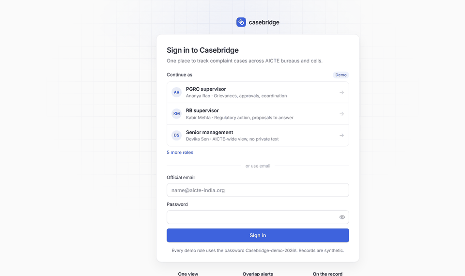
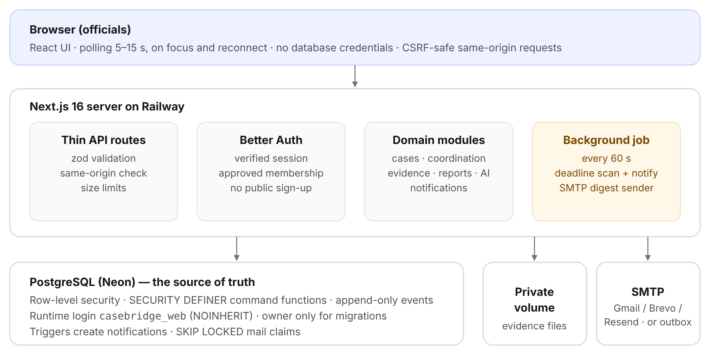
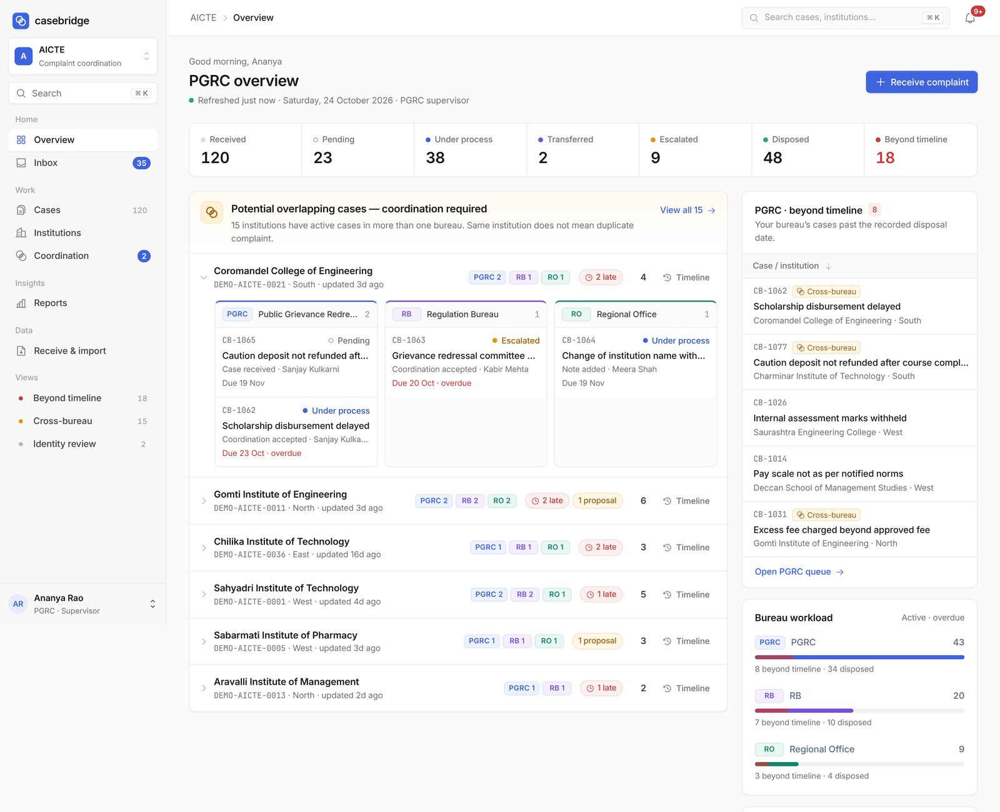
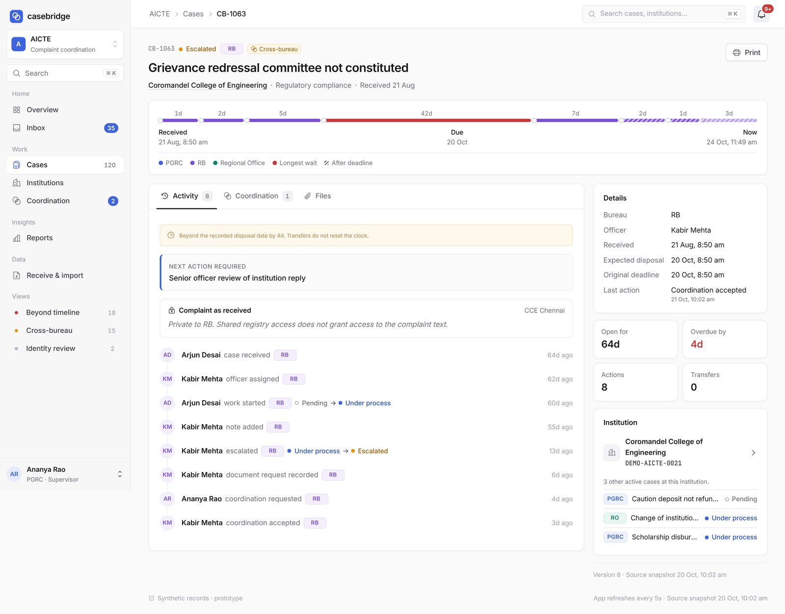

<div align="center">

# Casebridge · by Team AGNEYA

**One view of every complaint about an institution, across AICTE bureaus and cells.**

[**Live app →**](https://casebridge-4kjs.onrender.com) &nbsp;·&nbsp; Demo video: [VIDEO_URL]



</div>

**Try it:** open the live app and click any role on the sign-in page (synthetic data only). Manual sign-in: `ananya.pgrc@demo.casebridge.test` / `Casebridge-demo-2026!`. The free host may take ~30 s to wake up.

## What it does
- Tracks every complaint with an owner, status, next action and deadline.
- Links complaints to one institution profile, even when the name is written differently.
- Alerts supervisors (in-app and e-mail) when **two or more bureaus act on the same institution**: *“Potential overlapping cases — coordination required.”*
- Lets bureaus coordinate. **Nothing is merged, closed or hidden automatically**; every action is recorded and transfers keep the original deadline.
- Search, dashboards and reports by bureau, region, institution and status, with PDF, print and CSV export.

## Architecture


Next.js · React · TypeScript · PostgreSQL with row-level security · Better Auth · SMTP alerts.

## What is in this repository
| Path | Contents |
|---|---|
| `src/components` | All user-interface components (shell, case page, overlap view, notifications, reports) |
| `src/contracts` | zod schemas and shared types for every request and response |
| `src/app` | Layout, design tokens and styles |
| `docs` | Diagrams and screenshots |

**Not published:** the server, authentication, database schema and policies, overlap and alert logic, institution matching and tests. The code here typechecks (`npm install && npm run typecheck`) but does not run as a full app; use the live link. Evaluators can request read-only access to the complete implementation.

## Screenshots
| | |
|---|---|
|  |  |

## No scraping, crawling or AI training
This repository and the live application are published **only for evaluation**.

Automated access is **not permitted** without our express written permission. This includes crawlers, scrapers, bots, spiders, and use as training data for AI or machine-learning models. The same applies to the live application.

```
User-agent: *
Disallow: /
```

## Copyright
© 2026 Team AGNEYA. All rights reserved. No licence is granted; you may not copy, modify, redistribute or reuse this work. See [COPYRIGHT.md](COPYRIGHT.md).

**Team AGNEYA** · Rushi Maddewad and team · [CONTACT_EMAIL]
